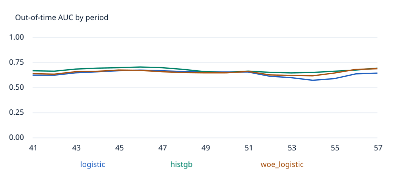
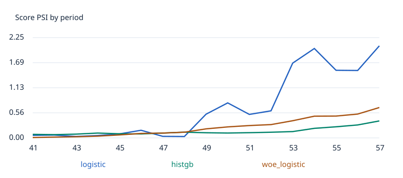

# 房贷贷后违约预警与模型监控

基于美国住宅抵押贷款面板数据，在每个观测期为仍在贷的借款人估计未来 3 期的违约风险。项目用 SQL 构建时点样本和历史特征，对比原始特征逻辑回归、WOE 逻辑回归与直方图梯度提升树，并通过时间外回测和逐期评分 PSI 评估模型。

## 数据集

使用 [Credit Risk Analytics 发布的 Mortgage 数据集](https://www.creditriskanalytics.net/datasets-private2.html)。数据来自美国住宅抵押贷款支持证券（RMBS）的底层贷款组合，约含 5 万名借款人。原始 CSV 有 622,489 条记录、23 列，覆盖 60 个匿名化观测期。每行记录一笔贷款在某一期的状态，同一笔贷款可以跨多期出现。

- **标识与时间**：`id` 为借款人 ID，`orig_time` 为放款期，`time` 为观测期。
- **放款信息**：`FICO_orig_time` 为放款时的 FICO 评分，`LTV_orig_time` 为放款时的贷款价值比。
- **贷后表现**：`balance_time` 为期内贷款余额，`LTV_time` 为观测期贷款价值比，`interest_rate_time` 为观测期利率。
- **事件状态**：`status_time` 的取值为 `0`（未违约且未结清）、`1`（违约）、`2`（结清）。项目用该字段生成未来违约标签。

数据引用：Baesens、Rösch 和 Scheule，*Credit Risk Analytics: Measurement Techniques, Applications, and Examples in SAS*，Wiley，2016。

## 样本构建

删除 305 条完全重复记录后，按借款人 ID 和放款期识别贷款。若同一组合在同一期仍有冲突记录，则剔除整个组合，共剔除 10 个组合。

- **特征**：使用评分时点及此前可得的信息，包括当前余额、贷款价值比（LTV）、放款时 FICO 评分，以及最近三次观测的余额和 LTV 均值。
- **标签**：未来 3 期内首次违约记为正类。窗口内先提前结清，或到窗口末仍可追踪且未违约，记为负类。标签窗口内出现缺期时，仅当首次事件在连续可观察区间内发生才保留标签。缺期后的事件和观察不足均标为未知。
- **时间切分**：训练样本的标签窗口最晚在第 40 期结束，测试样本的评分时点从第 41 期开始。两个集合有 12,735 位重叠借款人，回测衡量的是模型在存量房贷组合上的跨期表现。

## WOE、IV 与风险分层

连续特征按训练集分位数分箱，缺失单独成箱。好坏样本计数各加 0.5 做平滑，WOE 使用坏样本占比与好样本占比之比的自然对数。测试集直接应用训练箱边界和 WOE。风险分层使用训练预测的五分位边界，报告时间外各层的实际违约率和平均预测分数。

## 回测结果

训练集有 341,876 条记录，时间外测试集有 167,582 条标签已知记录，实际违约率 5.16%，另有 953 条未知标签。

| 模型 | AUC | KS | 平均精确率 |
| --- | ---: | ---: | ---: |
| 原始特征逻辑回归 | 0.686 | 0.282 | 0.094 |
| WOE 逻辑回归 | 0.679 | 0.261 | 0.102 |
| 直方图梯度提升树 | 0.702 | 0.301 | 0.105 |





PSI 使用全部可评分样本。逐期 AUC、KS、平均精确率和实际违约率使用已知标签，缺少任一类别时区分度指标留空。

- [总体回测指标](results/metrics.json)
- [逐期监控](results/monitoring.csv)
- [WOE 分箱与 IV](results/woe_iv.csv)
- [时间外风险分层](results/risk_tiers.csv)

## 复现

从发布方下载 [Mortgage CSV 压缩包](https://www.creditriskanalytics.net/uploads/1/9/5/1/19511601/mortgage_csv.rar)，解压至 `data/mortgage.csv`，然后在仓库根目录运行：

```bash
python -m pip install -r requirements.txt
python run.py data/mortgage.csv --cutoff 40 --horizon 3 --output results/local
```

运行 `python test_pipeline.py` 可检查违约、提前结清、缺期、观察不足和 WOE 编码。如需用 LightGBM 对比逻辑回归，可额外安装 `lightgbm` 并添加 `--booster lightgbm`。

SQL 特征与标签定义见 [features.sql](features.sql)，训练和评估入口见 [run.py](run.py)。
